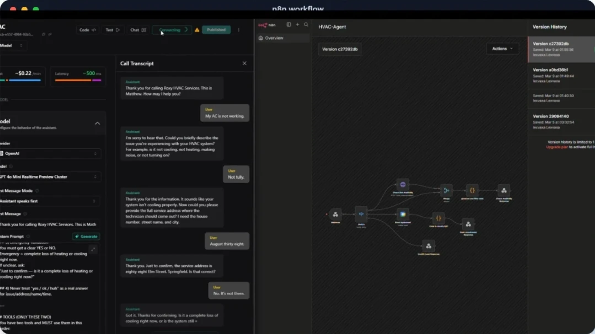
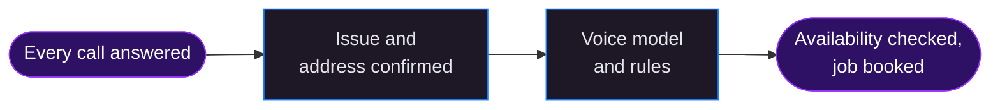

<!-- styled:v2 -->

**An AI voice receptionist built with n8n and GPT-4o that answers HVAC calls, qualifies leads, books jobs and flags emergencies.**

  
  
  
  
  
  
  
  

  <a href="#overview">Overview</a> ·
  <a href="#how-it-works">How it works</a> ·
  <a href="#key-features">Key features</a> ·
  <a href="#results">Results</a> ·
  <a href="#screens">Screens</a> ·
  <a href="#tech-stack">Tech stack</a>

---

## Overview

An HVAC company missed calls and spent staff time qualifying leads and scheduling jobs. We built an AI voice agent that answers every call, collects the issue and verifies the address, qualifies the lead, checks availability and books the appointment. Cancellations and urgent heating or cooling failures are handled and flagged, so calls turn into booked jobs without staff handling every one.

## The challenge

Calls went unanswered at busy times, and the team spent hours qualifying callers and arranging technician visits by phone.

## The solution

A realtime voice agent (GPT-4o) connected to n8n tools: it collects issue details, verifies the service address, qualifies the lead, checks technician availability, books the job and escalates emergencies.

## How it works

1. **Every call answered.** The voice agent answers in the company's name and asks what the problem is, in a natural conversation.
2. **Issue and address confirmed.** It asks the right questions about the fault, then reads the service address back to confirm it.
3. **Voice model and rules.** A realtime GPT-4o voice model runs with clear rules for emergencies, confirmations and which tools to use.
4. **Availability checked, job booked.** n8n tools check technician availability, book the appointment and log the lead in the CRM.

## Key features

- Answers every call in a natural voice
- Collects issue details and verifies the address
- Qualifies leads and checks availability
- Books appointments automatically
- Handles cancellations and flags emergencies

## Results

- Calls turn into booked appointments
- Emergencies flagged to the team immediately
- Staff no longer handle every routine call

## Tech stack

     

## Screens

## Privacy

Client names and records are confidential. Every screen in this repository uses sample data, and source code that belongs to the client is not published.

## Links

- Case study on Lexvaxa: https://lexvaxa.com/work/hvac-ai-voice-receptionist

---

**Built by [Ch Muhammad Samiullah](https://github.com/samiullah156-creator)** · AI Automation Engineer and Full-Stack Developer at [Lexvaxa](https://lexvaxa.com)

⭐ Star this repo if you found it useful

